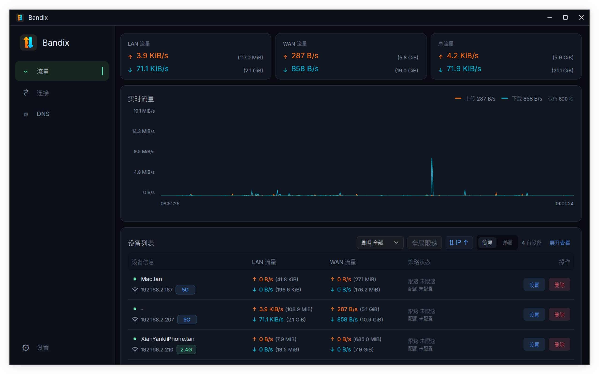
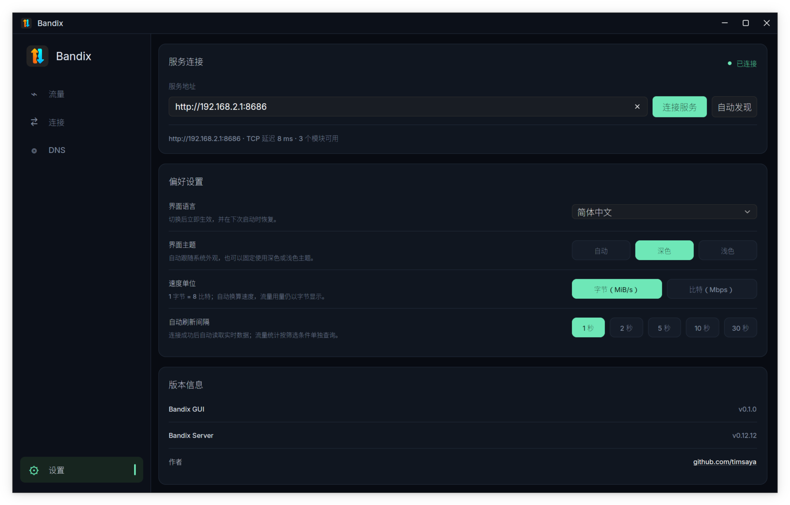

# Bandix GUI

English | [简体中文](README.zh.md)


A desktop client for [Bandix](https://github.com/timsaya/bandix), built with Rust and GPUI Kit. Connect to the Bandix service on your router to monitor network activity and manage device policies.

The GUI is a separate client: traffic collection, history storage, rate limiting and quota enforcement run on the Bandix server. Installing the GUI does not install the server or require LuCI on the desktop.

## Features

- Real-time upload/download charts, historical traffic, device usage and rankings.
- Device search, sorting, hostname editing, individual and batch deletion.
- Scheduled upload/download rate limits, global default limits and a whitelist.
- Combined or independent upload/download quotas, with minute, hour, day, week, month and lifetime limits. Only one quota mode is active at a time; combined mode is the default.
- Connection monitoring with filters and GeoIP information when provided by the server.
- DNS statistics and query records with filtering and pagination.
- Automatic default-gateway discovery on Linux and macOS, plus manual server connection.
- Light, dark and system themes; configurable refresh intervals and speed units.
- English, Simplified Chinese, Traditional Chinese, Japanese, French, Spanish, Polish and Russian.

## Screenshots

Traffic dashboard



Connection and display settings



## Install and run

### Linux

Available packaging formats are AppImage, tar.gz, DEB and RPM for `x86_64` and `aarch64`. Packages target **glibc 2.35 or later** and require a working graphical environment. Graphics drivers and some desktop libraries come from the host system.

The following examples use version `0.1.0` on `x86_64`; substitute the version and architecture of your package.

**Debian / Ubuntu:**

```sh
sudo apt install ./bandix-gui-0.1.0-linux-x86_64.deb
```

**Fedora / RPM-based systems with DNF:**

```sh
sudo dnf install ./bandix-gui-0.1.0-linux-x86_64.rpm
```

Start **Bandix GUI** from the applications menu or run `bandix-gui`. AppImage and tar.gz user installations use the same menu name.

**AppImage:**

```sh
chmod +x bandix-gui-0.1.0-linux-x86_64.AppImage
./bandix-gui-0.1.0-linux-x86_64.AppImage
```

Add `--appimage-extract-and-run` if FUSE is unavailable. To copy the AppImage into your user applications directory and register its launcher and icons:

```sh
./bandix-gui-0.1.0-linux-x86_64.AppImage --appimage-extract-and-run --install
```

This optional installation requires Python 3, does not require root, and supports reinstalling a newer version. For the tar.gz package, extract it and run `./AppRun` inside the extracted directory; `./AppRun --install` registers a user installation.

See [Linux packaging](packaging/linux/README.md) for dependencies, checksums, installation paths and compatibility details.

### macOS

The packaging script produces `.app`, `.zip` and `.dmg` outputs for Apple Silicon and Intel Macs, either separately or as a universal bundle. Open the DMG and drag `Bandix GUI.app` to Applications, or extract the ZIP and copy `Bandix GUI.app` there. The installed application is named **Bandix GUI**.

Output names use `bandix-gui-<version>-macos-<arch>`, for example `bandix-gui-0.1.0-macos-arm64.dmg`. The architecture is `arm64`, `x86_64` or `universal`.


## Connect to Bandix

1. In the router's LuCI Bandix settings, set the listening Host to `0.0.0.0` or the IPv4 address of the router's LAN interface, such as `192.168.1.1`, then save and apply. Enter an IP address, not an interface name such as `br-lan`.
2. Launch Bandix GUI to discover the service automatically. If needed, enter the router's address in the GUI settings, for example `http://192.168.1.1:8686` (use your configured port).


## Related projects and license

- [Bandix server](https://github.com/timsaya/bandix)
- [LuCI application](https://github.com/timsaya/luci-app-bandix)
- [OpenWrt service package](https://github.com/timsaya/openwrt-bandix)
- Maintainer: [timsaya](https://github.com/timsaya)
